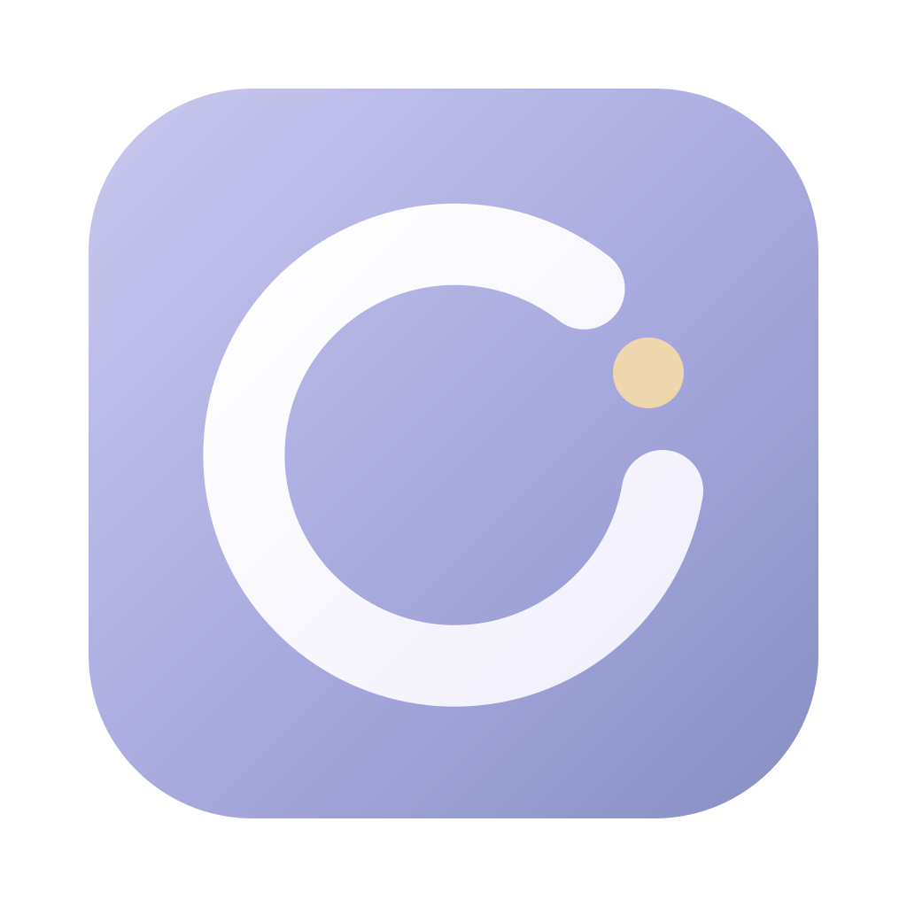

<p align="center">
  
</p>

<h1 align="center">Orvia</h1>
<p align="center"><strong>用一块 Magic Trackpad，快速调用常用操作。</strong></p>
<p align="center">简体中文 · <a href="README.md">English</a></p>

https://github.com/user-attachments/assets/e4998c96-6128-473e-bc98-07fbc3015a09

Orvia 是一款 macOS 触控板快捷轮盘，适合想用语音 Vibe Coding、放下键盘的你。双指轻放并长按，轮盘就会出现在鼠标旁；滑向目标选择操作，抬起手指关闭。复制、粘贴和常用快捷键，都可以在触控板上完成，也能更方便地调用你常用的语音输入工具。

## 功能

- **方便调用语音输入。** 把常用输入法或语音工具的「按住说话」快捷键绑定到轮盘，滑入按住、松手释放，用熟悉的工具说话输入，手不必移到键盘上。
- **按场景自动切换。** 为不同应用设置专属轮盘，也可以为文本输入单独配置。应用和文本框聚焦条件可以组合，一个场景也能覆盖多个应用。
- **自由定制轮盘。** 增减扇区、拖动排序、旋转方向，自定义名称和图标。每个动作可以单独选择移入触发、松手触发；按键还支持移入按住、移出释放。
- **快捷键、文字和快捷指令。** 录制组合键、插入常用短语、运行系统快捷指令，或打开悬浮键盘。快捷文字支持换行、emoji，以及输入后自动按 Enter。
- **外观与配置。** 简约和液态玻璃两种主题，跟随系统浅色、深色模式；支持中英文界面、配置导入导出和开机启动。

## 使用案例

| 场景 | 轮盘配置示例 |
| --- | --- |
| 和 AI 写代码 | 调用语音工具输入需求，搭配粘贴、回车和常用编辑器快捷键 |
| 回复消息 | 输入法的语音快捷键、常用回复、换行；为指定短语开启输入后自动按 Enter |
| 编辑文档 | 在文本框聚焦时使用复制、粘贴、撤销和光标移动 |
| 运行日常流程 | 把常用的系统快捷指令放进轮盘，随手启动 |

例如，输入法使用右 Option 按住说话时，将一个扇区绑定为右 Option，触发方式选「移入按住，移出释放」即可。双指长按唤出轮盘，滑入该扇区开始说话，松手结束。

## 构建与使用

需要 **Xcode 26+，或包含 macOS 26 SDK 的 Command Line Tools**。下载或克隆仓库后，在根目录运行：

```bash
bash Source/build.sh
open outputs/Orvia.app
```

首次打开后，在「系统设置 → 隐私与安全性 → 辅助功能」允许 Orvia。点击轮盘扇区配置动作，再切回目标应用，双指轻放约 **0.45 秒**即可唤出。关闭设置窗口后，应用会继续在菜单栏运行。

已在 **Apple Silicon + macOS 26** 上验证，支持原生液态玻璃效果。

详细操作见[使用指南](docs/user-guide.zh-CN.md)。测试、打包和签名说明见[开发文档](docs/development.md)，配置格式见[设置文件说明](docs/settings-format.zh-CN.md)。

## 许可证

[MIT](LICENSE)
